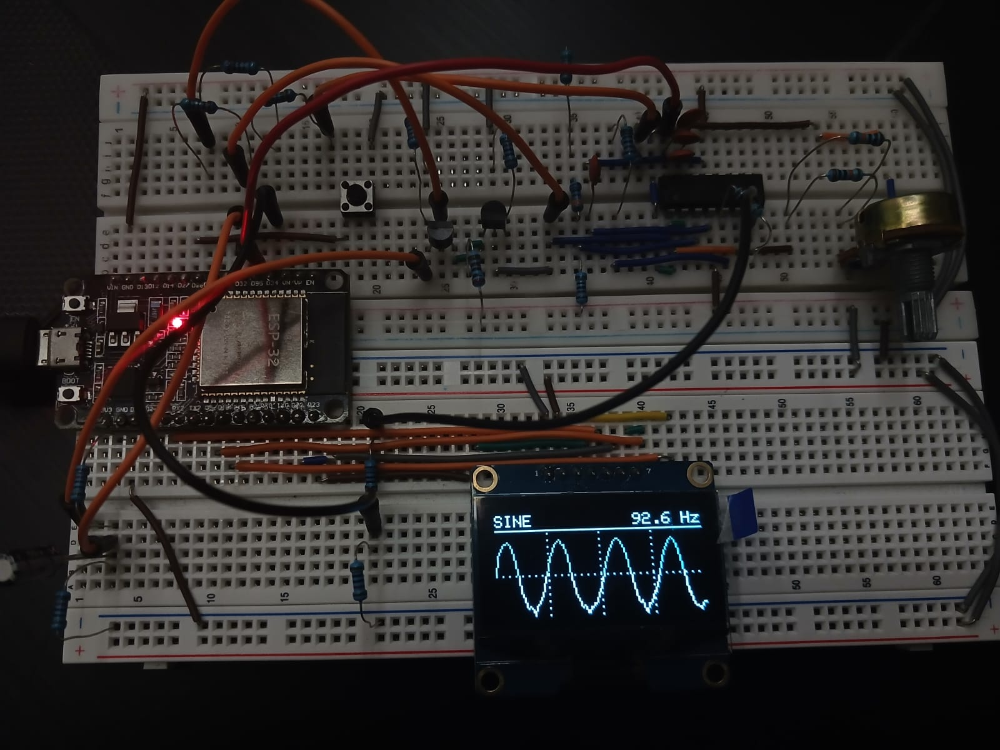
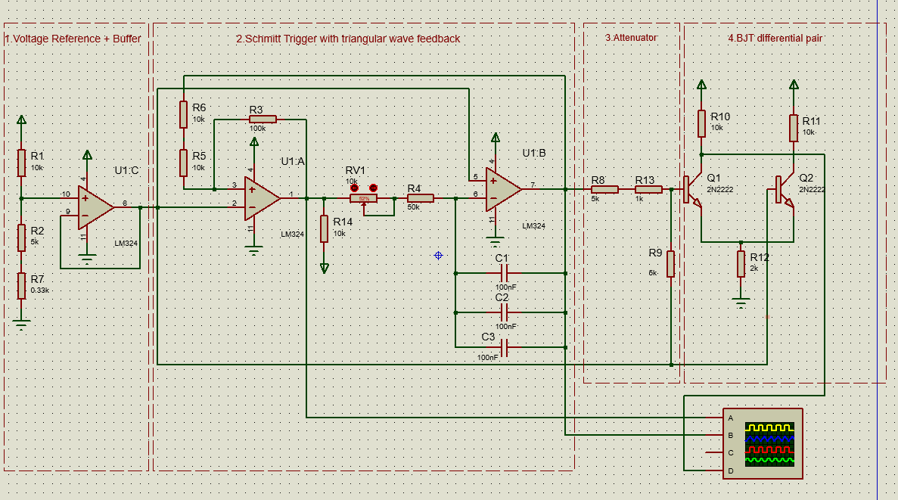
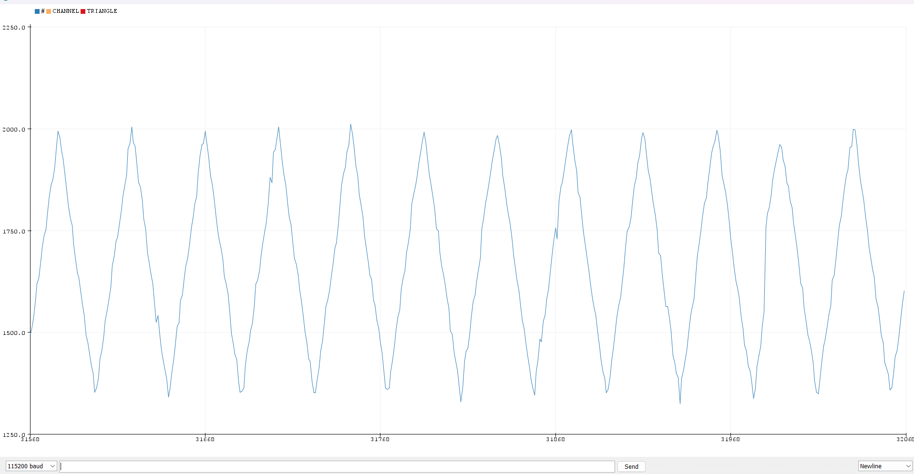
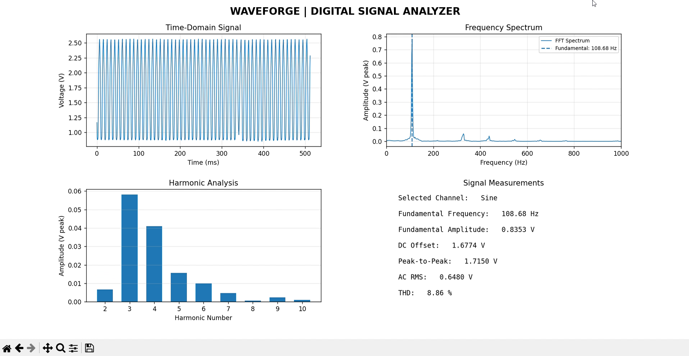

# WaveForge

**A breadboard function generator (square, triangle, sine) with a home-made ESP32 oscilloscope and FFT/THD analyzer.**

WaveForge generates three waveforms using nothing but an LM324 quad op-amp, two 2N2222 transistors and a handful of passives. An ESP32 then lets you *look at* those signals three different ways: on a tiny SPI OLED oscilloscope, in the Arduino Serial Plotter, and in a Python FFT dashboard that measures the harmonic distortion (THD) of the sine wave so the analog circuit can be tuned with real numbers.

https://github.com/user-attachments/assets/REPLACE-WITH-DEMO-VIDEO-URL

> If the video above does not play, open [`Images/Demo.mp4`](Images/Demo.mp4) directly.



*The finished breadboard build: the function generator (top), the ESP32 and the OLED oscilloscope showing the sine output at 92.6 Hz.*

---

## Table of contents

1. [How the project works](#how-the-project-works)
2. [Proteus simulation vs. real life: the 4.2 V vs. 3.2 V story](#proteus-simulation-vs-real-life-the-42-v-vs-32-v-story)
3. [ESP32 oscilloscope (OLED)](#esp32-oscilloscope-oled)
4. [Tracking the waveforms with the Serial Plotter](#tracking-the-waveforms-with-the-serial-plotter)
5. [Optimizing the sine wave with FFT analysis](#optimizing-the-sine-wave-with-fft-analysis)
6. [Getting started](#getting-started)
7. [Repository structure](#repository-structure)

---

## How the project works

The generator is built around a single LM324 op-amp chip and two transistors. The signal passes through a chain of blocks, each with one job:

```
Reference  ->  Square wave generator  ->  Triangle wave generator  ->  Attenuator  ->  Differential pair  ->  Sine
```



*Proteus schematic, split into its four functional blocks. The oscilloscope in the corner shows the square, triangle and sine outputs.*

**1. Voltage reference + buffer.** Everything runs from a single supply, so a resistor divider creates a stable mid-level voltage that acts as the "zero" around which all the waveforms swing. An op-amp buffer keeps this reference steady while several parts of the circuit draw from it.

**2. Square and triangle waves: the relaxation oscillator.** A comparator with positive feedback (a Schmitt trigger) and an integrator are connected in a loop. The comparator outputs the **square wave**; the integrator turns that square wave into ramps, producing the **triangle wave**. When the triangle reaches the comparator's upper or lower threshold the comparator flips, the ramp reverses, and the cycle repeats on its own, with no external clock.

**Variable frequency with a potentiometer.** The speed of the ramp depends on the resistance in front of the integrator. A **potentiometer** is part of that resistance, so turning it changes how fast the triangle rises and falls, and therefore changes the frequency of the square and triangle waves. This is the frequency knob of the generator.

**3. Attenuator.** The triangle wave is too large for the next stage, so a resistor divider scales it down to a few tens of millivolts, centered on the reference voltage.

**4. BJT differential pair: triangle to sine.** A triangle wave contains sharp corners. A transistor differential pair has a smooth, S-shaped (hyperbolic tangent) response, so when the small triangle is fed into it the peaks are rounded off and the output becomes a **sine wave**. The sine quality depends on the amplitude of the triangle and the DC balance of the two transistors, which is what the [FFT analysis](#optimizing-the-sine-wave-with-fft-analysis) is used to tune.

---

## Proteus simulation vs. real life: the 4.2 V vs. 3.2 V story

A simulation is an idealized model; a real circuit has real components with real limits. This project is a good example.

|                                  | Proteus simulation | Real circuit |
| -------------------------------- | :----------------: | :----------: |
| **Op-amp output HIGH (square wave)** |   **~4.2 V**   |  **~3.2 V**  |

The LM324 does not have a rail-to-rail output, so its high level stops well below the supply. The Proteus model is more forgiving and reaches about 4.2 V, while the real chip only reaches about 3.2 V.

**Why it matters:** the triangle amplitude is proportional to the square-wave swing, so the real triangle (and the signal that reaches the transistor pair) is about 25 % smaller than in the simulation. The attenuation and operating point chosen in the simulation therefore under-drive the real differential pair, and the sine is less rounded than expected. The values had to be **re-tuned on the real circuit**.

**Takeaway:** the simulation is excellent for understanding the topology, but real-world limits (output swing, tolerances, noise, ground and supply behavior) only show up on the bench, so the final design must always be validated and adjusted on the real hardware.

---

## ESP32 oscilloscope (OLED)

The `Oscilloscope/` sketch turns an ESP32 and a 128x64 SSD1306 SPI OLED into a small, self-triggering oscilloscope for the three waveforms. A push button cycles through **SQUARE -> TRIANGLE -> SINE**.

**Features**

* Rising-edge trigger with hysteresis so the trace is stable.
* One sample per pixel column (128 samples per sweep).
* **Automatic time base:** aims for about 32 samples per cycle.
* Frequency measurement using interpolated rising-edge crossings and a median over several periods.
* "NO SIGNAL" detection when the peak-to-peak is below 55 mV.
* Averaged, calibrated ADC readings (`analogReadMilliVolts`).

**Pin map**

| Function         | ESP32 GPIO |
| ---------------- | :--------: |
| OLED MOSI        |     23     |
| OLED SCK         |     18     |
| OLED CS          |      5     |
| OLED DC          |     22     |
| OLED RST         |      4     |
| Channel button   |     27 (to GND, internal pull-up) |

**Signal inputs and conditioning**

The ESP32 ADC only accepts voltages between 0 and 3.3 V, so each signal is conditioned before it reaches the board:

| Signal   | ESP32 GPIO | Input conditioning                                                                 |
| -------- | :--------: | ---------------------------------------------------------------------------------- |
| Square   |     34     | **Voltage divider** (10 kΩ / 10 kΩ) that halves the signal; the firmware multiplies the reading by 2 to restore the true voltage |
| Triangle |     35     | Connected directly                                                                 |
| Sine     |     32     | **AC coupling (decoupling) network**: a series capacitor removes the DC level, and a voltage divider re-centers the sine inside the ADC range |

The code is split into `Button`, `Sampler`, `Display` and `Config` modules; every pin and tuning constant lives in `Config.h`.

---

## Tracking the waveforms with the Serial Plotter

Before building the OLED scope, the quickest way to see the generator's output is the **Arduino IDE Serial Plotter**, using `Serial_Plotter/Serial_Plotter.ino`.



*Triangle wave captured live in the Arduino Serial Plotter.*

**How it works**

1. The ESP32 reads the selected input with `analogReadMilliVolts()` every 250 us (about 4 kS/s) and prints **one number per line** at 115200 baud. The Serial Plotter draws each new number as the next point on the graph, so the value is in millivolts and the x-axis is the sample index.
2. The button on GPIO 27 cycles the channel (square, triangle, sine). The channel name is printed as a comment line, which appears in the plotter's legend.
3. Open **Tools -> Serial Plotter**, select **115200 baud**, and the waveform appears immediately.

**What the capture tells us:** the triangle oscillates between about 1350 mV and 2000 mV (~650 mV peak-to-peak, which confirms the reduced real-world amplitude explained above), with about 11 cycles in 500 samples (roughly 90 Hz). The small spikes on the edges are ADC noise and the limits of sampling a ~100 Hz signal at only a few kS/s, which motivated the dedicated FFT analyzer below.

---

## Optimizing the sine wave with FFT analysis

Looking at a sine on an oscilloscope can tell you it "looks right", but it cannot tell you *how* right. To tune the BJT stage with numbers, WaveForge includes an **FFT / THD analyzer**:

```
 Signal --> ESP32 ADC (8 kHz, 4096 samples) --> binary packet over USB (921600 baud) --> Python: FFT + THD + dashboard
```

* `WaveForge_FFT_Analyzer/` (Arduino): captures 4096 calibrated samples at 8 kHz and sends them in a binary packet (header `WF`).
* `Python_FFT_Analyzer/` (Python): removes the DC offset, applies a **Hann window**, computes the FFT with `numpy.fft.rfft`, finds the fundamental with **parabolic peak interpolation**, measures harmonics 2 to 10 and computes THD.

```
THD (%) = sqrt( V2^2 + V3^2 + ... + V10^2 ) / V1 x 100
```



*The live dashboard: time-domain signal, frequency spectrum, harmonic bar chart and measurements.*

**Reading the dashboard (sine channel)**

| Quantity               | Value       |
| ---------------------- | ----------- |
| Fundamental frequency  | 108.68 Hz   |
| Fundamental amplitude  | 0.8353 V    |
| Peak-to-peak           | 1.7150 V    |
| DC offset              | 1.6774 V    |
| **THD**                | **8.86 %**  |

The spectrum shows one dominant peak at the fundamental and only small harmonics. The harmonic chart is the useful part for debugging: here the **3rd harmonic (about 0.058 V)** is the largest, followed by the **4th (about 0.041 V)**.

**The tuning loop used on this project**

1. Measure THD with the analyzer.
2. Change one thing in the circuit.
3. Measure again and keep the change only if THD went down.


---

## Getting started

### Hardware

* ESP32 dev board (ESP32-WROOM)
* LM324 quad op-amp, 2 x 2N2222, resistors and capacitors as in the schematic
* 128x64 SSD1306 OLED (SPI) and one push button
* Breadboard and jumper wires

Connect a **common ground** between the ESP32 and the generator.

### Proteus simulation

Open `Proteus/Simulation.pdsprj` in Proteus 8 to explore the circuit.

### Arduino sketches

1. Install the **ESP32 board package** in the Arduino IDE.
2. Install the libraries from the Library Manager: **Adafruit GFX**, **Adafruit SSD1306** (oscilloscope) and **arduinoFFT** (FFT analyzer).
3. Open a sketch folder (`Oscilloscope`, `Serial_Plotter` or `WaveForge_FFT_Analyzer`), select your ESP32 board and upload.

### Python FFT dashboard

```bash
cd Python_FFT_Analyzer
pip install -r requirements.txt
```

1. Upload `WaveForge_FFT_Analyzer` to the ESP32.
2. Edit `SERIAL_PORT` in `config.py` (for example `COM6` on Windows or `/dev/ttyUSB0` on Linux).
3. Close the Arduino Serial Monitor / Plotter (only one program can use the port), then run:

```bash
python main.py
```

---

## Repository structure

```
WaveForge/
├── Images/                     Photos, schematic, plots and demo video
├── Proteus/                    Proteus simulation project
├── Oscilloscope/               ESP32 + OLED oscilloscope
├── Serial_Plotter/             Simple sketch for the Arduino Serial Plotter
├── WaveForge_FFT_Analyzer/     ESP32 firmware: sampling + binary packets
└── Python_FFT_Analyzer/        Python FFT, THD and dashboard
```

---

## Author

**Ali Moussa**, Electrical & Electronics Engineering student 
